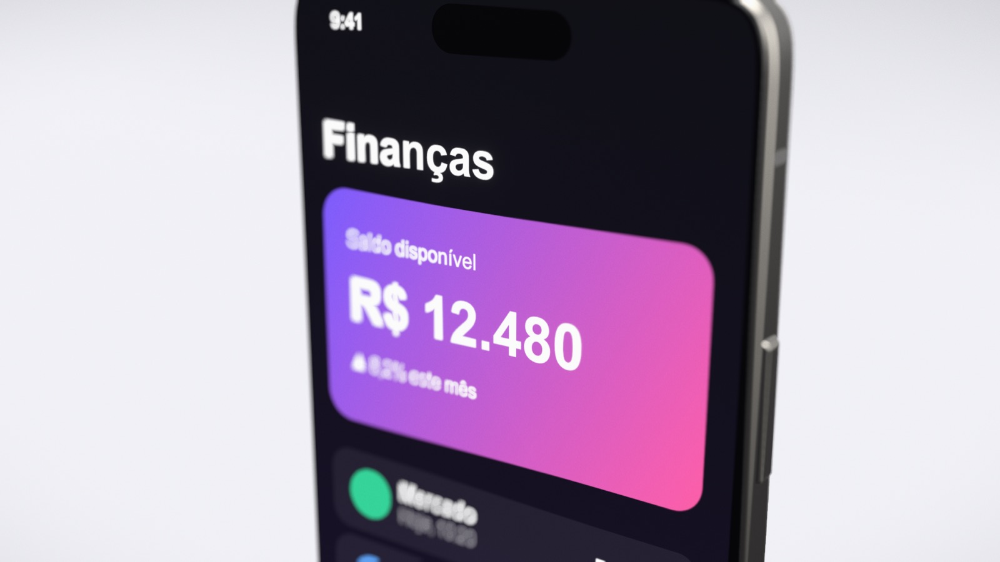
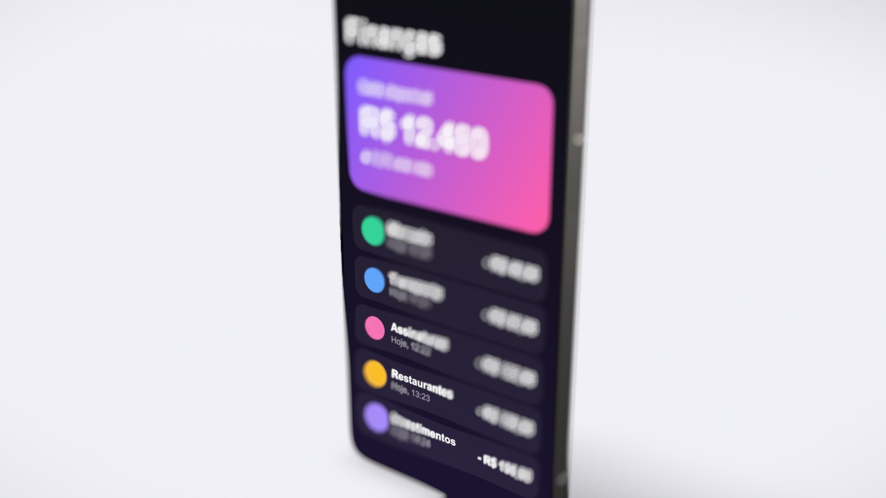
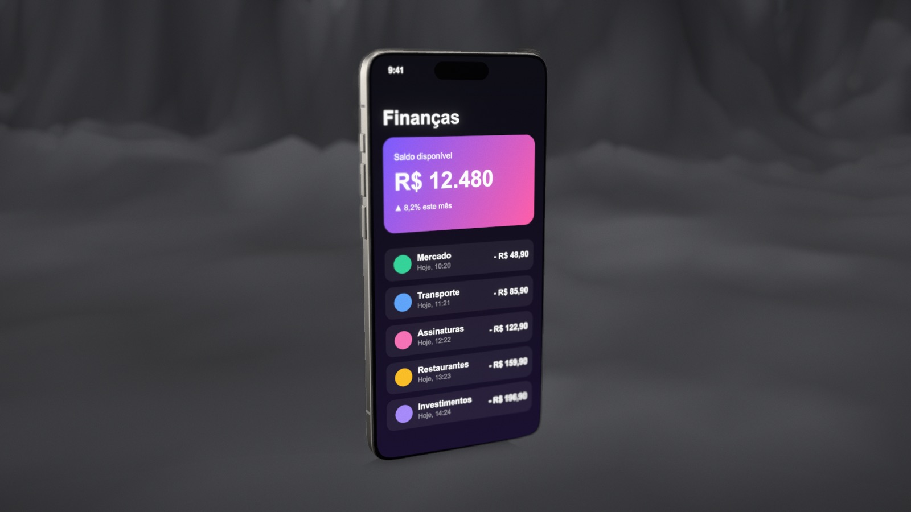
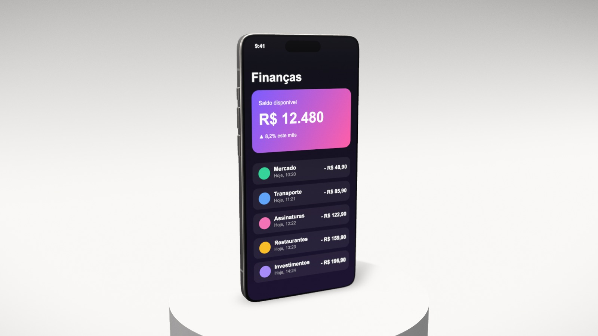

# Mockup 3D

Editor de mockups 3D no navegador: coloca prints e gravações de tela de apps e sites dentro de aparelhos 3D (iPhone, iPad, MacBook e janela de navegador), com cenários de estúdio, desfoque com bokeh, animações de câmera e exportação em PNG (até 4K, com fundo transparente) e vídeo MP4.

**▶ Testar agora: https://atendimento3ads.github.io/mockup-3d/**

Tudo roda no seu navegador: as imagens e vídeos que você envia não saem do seu computador.

| | |
|---|---|
|  |  |
|  |  |

## O que dá para fazer

- **Aparelhos:** iPhone (proporções do 16 Pro), iPad, MacBook e janela de navegador, modelados em código, com acabamentos, rotação, orientação e posição no quadro.
- **Mídia:** print (PNG, JPG, WebP) ou gravação de tela (MP4). Cole com ⌘V, arraste ou envie. Prints longos de site podem rolar, e vídeos tocam sincronizados com a linha do tempo.
- **Cena:** estúdio infinito, pódio, rochas, dunas ou uma foto sua ao fundo; cinco luzes de estúdio e sombra macia.
- **Foco:** níveis de desfoque prontos (Sutil → Macro). Dê duplo clique no aparelho para escolher o ponto de foco.
- **Animação:** nove presets (close cinematográfico, foco que passeia, revelação 360, órbita lenta…), áreas de foco desenhadas sobre o print, quadros-chave, cortes secos entre planos, flutuação e ritmos (suave, contínuo, dinâmico…).
- **Cenas:** vários aparelhos e prints no mesmo vídeo. Cada cena da linha do tempo tem aparelho, mídia e movimento próprios; luz, cenário e foco valem para todas.
- **Exportar:** PNG até 4K e vídeo MP4 (H.264, 30 ou 60 fps), gravado quadro a quadro.

## Rodar localmente

```bash
npm install
npm run dev   # http://127.0.0.1:5199
```

## Controle pelo Claude (MCP)

Rodando localmente, o servidor MCP (`mcp/server.mjs`) permite que o Claude monte a cena, anime e exporte no editor aberto. Ele fala com a aba do editor por uma ponte que só existe no servidor de desenvolvimento (`bridge/vite-mcp-bridge.ts`); essa ponte aceita apenas chamadas da própria máquina e não existe na versão publicada.

```bash
claude mcp add --scope user mockup-3d -- node /caminho/para/mockup-3d/mcp/server.mjs
```

Depois é só pedir numa conversa, por exemplo: "Coloca o print ~/Desktop/app.png num iPhone preto no cenário de rochas, com desfoque forte, e exporta um vídeo 9:16."

## Como é feito

- [three.js](https://threejs.org) para o 3D e [postprocessing](https://github.com/pmndrs/postprocessing) para desfoque, bloom, grão e vinheta.
- Aparelhos, cenários e estúdios de luz são gerados em código: não há modelos 3D, texturas ou imagens de terceiros.
- Gravação de vídeo com [Mediabunny](https://mediabunny.dev) (MPL-2.0), carregado só na hora de exportar.
- Interface em React + Vite, com a fonte [Plus Jakarta Sans](https://fonts.google.com/specimen/Plus+Jakarta+Sans) (OFL) embutida no projeto.

## Estrutura

- `src/state.ts`: estado da cena (JSON) e presets.
- `src/scenes.ts`: operações com cenas na linha do tempo.
- `src/engine/`: renderizador, aparelhos, cenários, luz, sombra, efeitos e animação.
- `src/ui/`: controles, linha do tempo e áreas de foco.
- `src/styles.css`: visual da interface (claro e escuro).
- `src/mcp/`, `mcp/` e `bridge/`: comandos, servidor MCP e ponte local.
